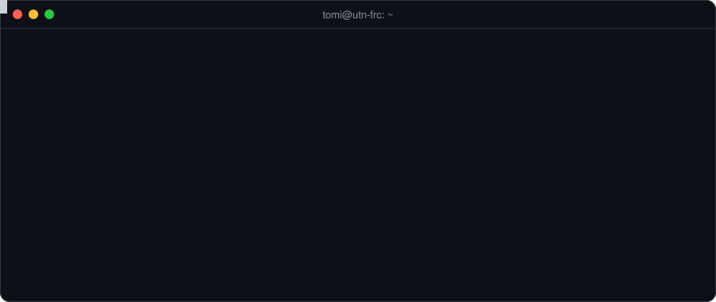
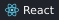
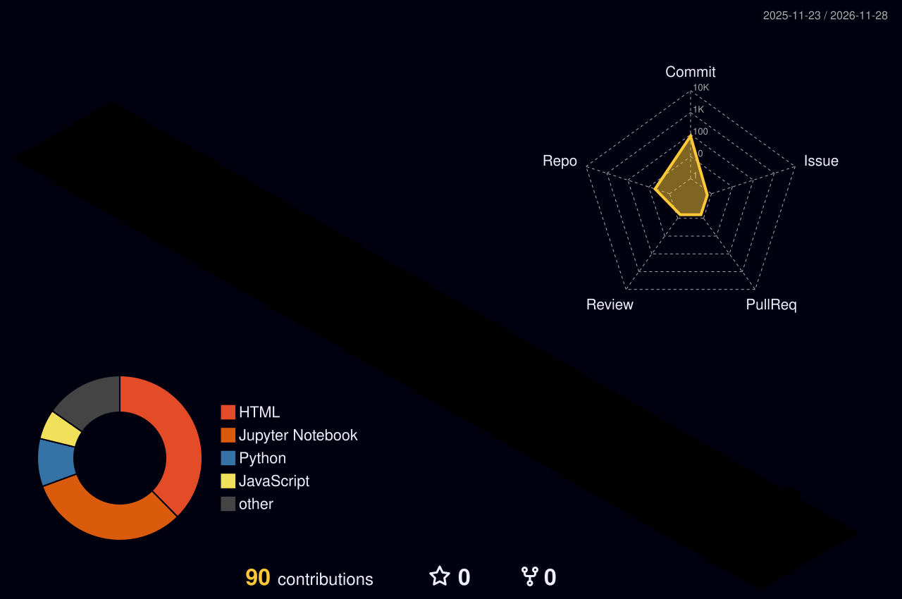

  

  

    
    
    
    
    
    
    
    
    
    
    
     
    
    
    
    
    
    
    
    
    
    
    
    
    
    
    
    
    
    
    
    
    
    
    
    
    
    
    
    
    
    
    
    
    
    

  📣 ¿Querés contactarme? Encontrame acá: 
  
  
  
  

<h3>⚡️ Backend · DevSecOps · IA aplicada ⚡️</h3>

  Estudiante avanzado de Ingeniería en Sistemas de Información orientado al desarrollo backend, la seguridad informática y la inteligencia artificial. Me gusta construir sistemas completos: desde la API y la base de datos hasta el despliegue en contenedores, la observabilidad y los controles de seguridad, sumando modelos de IA cuando aportan valor real.

  🧑‍💻 Soy <b>Tomás</b>, estudiante avanzado de <b>Ingeniería en Sistemas de Información</b> en la <a href="https://www.frc.utn.edu.ar">UTN FRC</a> (solo me resta la tesis) y de la <b>Licenciatura en Inteligencia Artificial</b>. 
  📍 Vivo en <a href="https://www.google.com/maps?q=cordoba+argentina">Córdoba</a>, Argentina. 
  🔐 Integrante de <b>GISSIC</b> (Grupo de Investigación en Seguridad de Sistemas de Información y Ciberseguridad), donde participo en un proyecto de investigación. 
  🛠️ Desarrollo APIs y microservicios con <b>Java/Spring Boot</b> y <b>Python/FastAPI</b>, automatizo despliegues con <b>CI/CD</b> y escaneo de seguridad, y trabajo con <b>OAuth 2.0, JWT y FIDO2</b>. 
  🤖 Integro modelos de <b>visión por computadora</b> y <b>LLMs</b> en sistemas funcionales. 
  🌱 Me apasionan la ciberseguridad y la IA.

  🔗 ¿Querés hablar de algún proyecto? Mandame un <a href="mailto:tomicarrio73@gmail.com?subject=[GitHub]%20Contacto">mail</a> o escribime por <a href="https://www.linkedin.com/in/tomi-carrio73/">LinkedIn</a>.

 

<h3>🛠️ Conocimientos técnicos</h3>

| Área | Tecnologías |
|---|---|
| **Lenguajes** | Java, Python, JavaScript, SQL, Bash |
| **Backend** | Spring Boot (Data, Security, Cloud Gateway), JPA/Hibernate, FastAPI, Flask, Node.js, Express · APIs REST, OpenAPI, WebSocket, microservicios |
| **Frontend** | React |
| **Bases de datos** | MySQL, MariaDB, SQL Server, SQLite, MongoDB · modelado y normalización |
| **Integración y mensajería** | RabbitMQ, webhooks, n8n |
| **IA y datos** | PyTorch, Hugging Face Transformers, Ultralytics (YOLO), SAM, OWLv2, Grounding DINO, LLMs (Qwen, Groq, Ollama), MCP, aprendizaje por refuerzo (Q-Learning), NumPy, pandas, Matplotlib, Jupyter |
| **DevOps y cloud** | Linux, Docker, Docker Compose, Kubernetes, GitLab CI/CD, GitHub Actions, Nginx, Azure (VM) |
| **Observabilidad y pruebas** | Prometheus, Grafana, Jaeger, JMeter, Postman/Newman, pytest, JUnit |
| **Seguridad** | OAuth 2.0 / OIDC (PKCE, client credentials), JWT, Auth0, WebAuthn/FIDO2, detect-secrets, Checkov, Trivy, Nmap, Wireshark, Burp Suite |
| **Redes** | Configuración básica de redes LAN/WAN y diagnóstico de conectividad |
| **Metodologías y herramientas** | Agile, Scrum, Kanban, UML, BPMN, C4, ADR, Git, VS Code, IntelliJ |

<h2 align="center">🚀 Proyectos</h2>

<h3>🤖 Inteligencia Artificial</h3>

#### [👁️ Detección y Comprensión de Objetos en Imágenes](https://github.com/TomiiC73/Proyectos/tree/main/IA%20-%20Modelo%20para%20detectar%20objetos%20en%20imagenes)

Sistema que <b>mira una imagen y la entiende</b>: detecta y segmenta cada objeto, describe la escena en un formato estructurado y responde preguntas sobre ella en lenguaje natural.

<ul>
  <li>Combina <b>cuatro detectores open-vocabulary</b> (SAM 3, OWLv2, Grounding DINO y YOLOE) con segmentación <b>SAM 2.1</b>.</li>
  <li>Calcula color, tamaño, posición y relaciones espaciales de cada objeto en un <b>SceneJSON</b> validado contra un esquema.</li>
  <li>Responde preguntas con un motor determinista o con un <b>LLM local (Qwen3)</b>, con inferencia optimizada en GPU.</li>
</ul>

  
  
  
  
  
  
  
  
  

#### [🦖 Agente de Aprendizaje por Refuerzo – Dinosaurio de Chrome](https://github.com/TomiiC73/Aprendizaje-Automatico)

Un agente que <b>aprende solo a jugar</b> al juego del dinosaurio de Chrome, esquivando cactus y pájaros a partir de recompensas.

<ul>
  <li>Modelado del entorno (estados, acciones y recompensas) con una interfaz estilo <b>Gymnasium</b>.</li>
  <li>Entrenamiento con <b>Q-Learning</b> y exploración ε-greedy, comparando lo aprendido contra la tabla Q óptima.</li>
</ul>

  
  
  

#### [🎤 Laboratorio de Prompt Injection](https://github.com/TomiiC73/Proyectos/tree/main/Charla%20IA)

Simulador de un <b>filtro de candidatos (ATS) con IA</b> que evalúa CVs en PDF con un LLM. Lo usé en una charla para mostrar en vivo cómo instrucciones ocultas en un documento o un correo <b>manipulan la decisión del modelo</b>.

<ul>
  <li>Análisis de CVs con un LLM vía API, lectura de PDFs y laboratorio de correo con IMAP/SMTP.</li>
</ul>

  
  
  
  

---

<h3>🔐 Ciberseguridad</h3>

#### [🏦 HackerBank – Pentesting con Autenticación FIDO2 (Hackertech UTN-FRC)](https://github.com/TomiiC73/Proyectos/tree/main/HackerTech%20-%20UTNFRC)

Banco ficticio usado como <b>laboratorio de seguridad</b> en el evento Hackertech de la UTN FRC, con un segundo factor de autenticación moderno basado en <b>passkeys</b>.

<ul>
  <li>Segundo factor con <b>WebAuthn/FIDO2</b> (huella, PIN, Windows Hello, Touch ID o llaves físicas) sin procesar datos biométricos en la app.</li>
  <li>Flujo completo de registro y verificación: challenge-response, validación de origen, clave pública y contador de uso.</li>
  <li>Guía para el equipo instructor y despliegue reproducible con Docker.</li>
</ul>

  
  
  
  
  
  

#### [💣 Escape Room HackerTech](https://github.com/TomiiC73/Proyectos/tree/main/EscapeRoomHackerTech%20-%20UTNFRC)

Primera versión del banco: un <b>escape room de ciberseguridad</b> donde los participantes tenían que vulnerar un reconocimiento facial sin detección de vida usando una foto.

<ul>
  <li>Login con reconocimiento facial, límite de intentos y una "bomba" que se desactiva al romper el segundo factor.</li>
</ul>

  
  
  
  

#### [🕵️ Banco Vulnerable para Práctica de Pentesting](https://github.com/TomiiC73/Proyectos/tree/main/Banco%20%28Seguridad%29)

Sistema bancario web con <b>vulnerabilidades intencionales</b> para practicar hacking ético: un CTF con desafíos y pistas escondidas en un sistema de archivos simulado.

<ul>
  <li>Vulnerabilidades de <b>RCE</b>, fallas de lógica en <b>OAuth2</b> (CSRF, client secret expuesto) y evasión de controles en <b>JWT</b>.</li>
  <li>Aplicación aparte con los enunciados de los desafíos, todo contenerizado.</li>
</ul>

  
  
  
  
  
  
  

---

<h3>⚙️ Backend, Integraciones y DevOps</h3>

#### [🚗 doctaCar – Alquiler de Vehículos](https://github.com/Shadow987654/TPI-IAEW)

Plataforma para <b>reservar autos en varias sucursales</b> sin que un mismo auto quede reservado dos veces: catálogo, registro de clientes, reservas, contratos y panel web.

<ul>
  <li>API REST <b>contract-first</b> (OpenAPI) con autorización por scopes con <b>Auth0</b> y endpoint con API key.</li>
  <li>Eventos asincrónicos con <b>RabbitMQ</b> y disponibilidad en tiempo real por <b>WebSocket</b>.</li>
  <li>Observabilidad con logs JSON, métricas en <b>Grafana</b> y trazas en <b>Jaeger</b>; pruebas de carga con JMeter y CI con GitHub Actions.</li>
</ul>

  
  
  
  
  
  
  
  
  
  
  
  
  

#### [🛫 Cierre de Rampa en Aeropuertos (n8n)](https://github.com/TomiiC73/Proyectos/tree/main/Proyectos%20n8n/aeropuertos-cierre-rampa-n8n)

Automatización que evalúa <b>condiciones meteorológicas y avisos aeronáuticos (NOTAMs)</b>, decide si hay que cerrar la rampa y avisa en paralelo a cada área del aeropuerto.

<ul>
  <li>Workflow de n8n autohospedado en una <b>VM Linux en Azure</b>, con un <b>LLM local (Ollama)</b> que extrae datos de los NOTAMs.</li>
  <li>Integración con APIs de clima y vuelos, reportes en PDF y notificaciones por Telegram, correo y Trello.</li>
</ul>

  
  
  
  
  
  
  

#### [🎮 Trivia en Vivo por Telegram (n8n)](https://github.com/TomiiC73/Proyectos/tree/main/Proyectos%20n8n/trivia-telegram-n8n)

Bot de <b>trivia en vivo</b> para charlas: los participantes juegan desde Telegram y un bot de administrador controla la partida y ve las respuestas en tiempo real.

<ul>
  <li>Máquina de estados (lobby, juego, ranking final) en n8n, con dos bots separados y tabla de clasificación automática.</li>
  <li>Scripts para importar y activar el workflow por la API REST de n8n, con tests de la lógica.</li>
</ul>

  
  
  
  

#### [🛡️ Pipeline CI/CD con Seguridad Automatizada](https://github.com/TomiiC73/Proyectos/tree/main/DevOps%20%28Gitlab%20CI-CD%29)

Aplicación de microservicios desplegada con un <b>pipeline de 8 etapas en GitLab</b> que incluye controles de seguridad en cada paso.

<ul>
  <li>Escaneo de secretos, linting, análisis de Dockerfiles e infraestructura (<b>Checkov</b>), build, escaneo de imágenes (<b>Trivy</b>), deploy y tests de producción.</li>
  <li>HTTPS con Nginx como proxy reverso.</li>
</ul>

  
  
  
  
  
  
  
  
  

#### [🐳 Aplicación de Microservicios Dockerizada](https://github.com/TomiiC73/Proyectos/tree/main/DevOps%20%28Docker%29)

Aplicación de tareas con <b>arquitectura de microservicios</b> totalmente contenerizada.

<ul>
  <li>Frontend React, API Flask, servicio de notificaciones FastAPI y Nginx como proxy reverso, orquestados con Docker Compose y Docker Secrets.</li>
</ul>

  
  
  
  
  
  
  

#### [🚙 Agencias – Pruebas de Manejo con Microservicios](https://github.com/TomiiC73/Proyectos/tree/main/Agencias)

Backend para que las agencias de autos <b>gestionen pruebas de manejo</b> de sus vehículos y notifiquen a los interesados.

<ul>
  <li>Microservicios con <b>API Gateway</b>, servicio de notificaciones desacoplado y autorización con <b>OAuth2</b>.</li>
</ul>

  
  
  
  
  
  
  

#### [🍷 BonVino – Ranking de Vinos](https://github.com/TomiiC73/Proyectos/tree/main/BonVino)

Aplicación web que <b>arma rankings de vinos</b> de bodegas a partir de las reseñas de sommeliers y los exporta a reportes.

<ul>
  <li>Backend en capas con el patrón de diseño <b>Iterator</b> y frontend en React conectado por API REST.</li>
</ul>

  
  
  
  
  

---

<h3>📈 Mi actividad en 3D</h3>

<picture>
  <source media="(prefers-color-scheme: dark)" srcset="profile-3d-contrib/profile-night-rainbow.svg"/>
  <source media="(prefers-color-scheme: light)" srcset="profile-3d-contrib/profile-green-animate.svg"/>
  
</picture>
