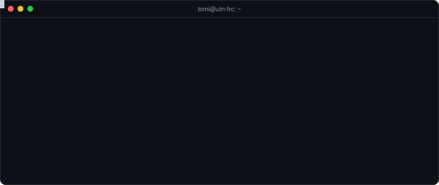
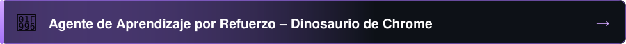
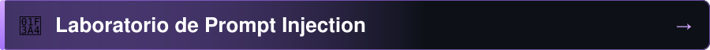
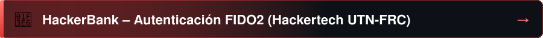
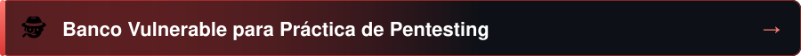

  

  

  
  
  
  
   
  

<i>Me gusta construir sistemas completos: desde la API y la base de datos hasta el despliegue en contenedores, la observabilidad y los controles de seguridad, sumando modelos de IA cuando aportan valor real.</i>

## 🧰 Tech Stack

#### 💻 Lenguajes

  
  
  
  
  

#### 🧩 Frameworks y librerías

  
  
  
  
  
  
  

#### 🗄️ Bases de datos

  
  
  
  
  

#### 🔗 Integración y APIs

  
  
  
  

#### 🧪 Testing y DevOps

  
  
  
  
  
  
  
  

#### 📈 Observabilidad

  
  
  

#### ☁️ Cloud y herramientas

  
  
  
  
  
  
  

#### 📋 Gestión de proyectos

  
  
  

## 🤖 Inteligencia Artificial

#### 🧠 Modelos y plataformas

  
  
  
  
  
  
  

#### ⚙️ Automatización

  
  

#### 📊 Datos y experimentación

  
  
  
  

> 🔧 Integro modelos de visión por computadora y LLMs locales en sistemas funcionales: detección y segmentación de objetos, extracción de datos estructurados con IA y automatizaciones que toman decisiones a partir de datos en tiempo real.

## 🔐 Ciberseguridad

#### 🔑 Autenticación y seguridad de aplicaciones

  
  
  
  
  

#### 🛡️ DevSecOps

  
  
  

#### 🕵️ Pentesting y análisis de red

  
  
  
  

> 🔧 Desarrollo laboratorios de pentesting con vulnerabilidades intencionales, implemento segundo factor con passkeys FIDO2 e integro escaneo de secretos, infraestructura e imágenes en los pipelines de CI/CD.

<h1 align="center">🚀 Proyectos</h1>

<h2>🤖 Inteligencia Artificial</h2>

Sistema que <b>mira una imagen y la entiende</b>: detecta y segmenta cada objeto, describe la escena en un formato estructurado y responde preguntas sobre ella en lenguaje natural.

<ul>
  <li>Combina <b>cuatro detectores open-vocabulary</b> (SAM 3, OWLv2, Grounding DINO y YOLOE) con segmentación <b>SAM 2.1</b>.</li>
  <li>Calcula color, tamaño, posición y relaciones espaciales de cada objeto en un <b>SceneJSON</b> validado contra un esquema.</li>
  <li>Responde preguntas con un motor determinista o con un <b>LLM local (Qwen3)</b>, con inferencia optimizada en GPU.</li>
</ul>

  
  
  
  
  
  
  
  
  

 

Un agente que <b>aprende solo a jugar</b> al juego del dinosaurio de Chrome, esquivando cactus y pájaros a partir de recompensas.

<ul>
  <li>Modelado del entorno (estados, acciones y recompensas) con una interfaz estilo <b>Gymnasium</b>.</li>
  <li>Entrenamiento con <b>Q-Learning</b> y exploración ε-greedy, comparando lo aprendido contra la tabla Q óptima.</li>
</ul>

  
  
  

 

Simulador de un <b>filtro de candidatos (ATS) con IA</b> que evalúa CVs en PDF con un LLM. Lo usé en una charla para mostrar en vivo cómo instrucciones ocultas en un documento o un correo <b>manipulan la decisión del modelo</b>.

<ul>
  <li>Análisis de CVs con un LLM vía API, lectura de PDFs y laboratorio de correo con IMAP/SMTP.</li>
</ul>

  
  
  
  

 

---

<h2>🔐 Ciberseguridad</h2>

Banco ficticio usado como <b>laboratorio de seguridad</b> en el evento Hackertech de la UTN FRC, con un segundo factor de autenticación moderno basado en <b>passkeys</b>.

<ul>
  <li>Segundo factor con <b>WebAuthn/FIDO2</b> (huella, PIN, Windows Hello, Touch ID o llaves físicas) sin procesar datos biométricos en la app.</li>
  <li>Flujo completo de registro y verificación: challenge-response, validación de origen, clave pública y contador de uso.</li>
  <li>Guía para el equipo instructor y despliegue reproducible con Docker.</li>
</ul>

  
  
  
  
  
  

 

Primera versión del banco: un <b>escape room de ciberseguridad</b> donde los participantes tenían que vulnerar un reconocimiento facial sin detección de vida usando una foto.

<ul>
  <li>Login con reconocimiento facial, límite de intentos y una "bomba" que se desactiva al romper el segundo factor.</li>
</ul>

  
  
  
  

 

Sistema bancario web con <b>vulnerabilidades intencionales</b> para practicar hacking ético: un CTF con desafíos y pistas escondidas en un sistema de archivos simulado.

<ul>
  <li>Vulnerabilidades de <b>RCE</b>, fallas de lógica en <b>OAuth2</b> (CSRF, client secret expuesto) y evasión de controles en <b>JWT</b>.</li>
  <li>Aplicación aparte con los enunciados de los desafíos, todo contenerizado.</li>
</ul>

  
  
  
  
  
  
  

 

---

<h2>⚙️ Backend, Integraciones y DevOps</h2>

Plataforma para <b>reservar autos en varias sucursales</b> sin que un mismo auto quede reservado dos veces: catálogo, registro de clientes, reservas, contratos y panel web.

<ul>
  <li>API REST <b>contract-first</b> (OpenAPI) con autorización por scopes con <b>Auth0</b> y endpoint con API key.</li>
  <li>Eventos asincrónicos con <b>RabbitMQ</b> y disponibilidad en tiempo real por <b>WebSocket</b>.</li>
  <li>Observabilidad con logs JSON, métricas en <b>Grafana</b> y trazas en <b>Jaeger</b>; pruebas de carga con JMeter y CI con GitHub Actions.</li>
</ul>

  
  
  
  
  
  
  
  
  
  
  
  
  

 

Automatización que evalúa <b>condiciones meteorológicas y avisos aeronáuticos (NOTAMs)</b>, decide si hay que cerrar la rampa y avisa en paralelo a cada área del aeropuerto.

<ul>
  <li>Workflow de n8n autohospedado en una <b>VM Linux en Azure</b>, con un <b>LLM local (Ollama)</b> que extrae datos de los NOTAMs.</li>
  <li>Integración con APIs de clima y vuelos, reportes en PDF y notificaciones por Telegram, correo y Trello.</li>
</ul>

  
  
  
  
  
  
  

 

Bot de <b>trivia en vivo</b> para charlas: los participantes juegan desde Telegram y un bot de administrador controla la partida y ve las respuestas en tiempo real.

<ul>
  <li>Máquina de estados (lobby, juego, ranking final) en n8n, con dos bots separados y tabla de clasificación automática.</li>
  <li>Scripts para importar y activar el workflow por la API REST de n8n, con tests de la lógica.</li>
</ul>

  
  
  
  

 

Aplicación de microservicios desplegada con un <b>pipeline de 8 etapas en GitLab</b> que incluye controles de seguridad en cada paso.

<ul>
  <li>Escaneo de secretos, linting, análisis de Dockerfiles e infraestructura (<b>Checkov</b>), build, escaneo de imágenes (<b>Trivy</b>), deploy y tests de producción.</li>
  <li>HTTPS con Nginx como proxy reverso.</li>
</ul>

  
  
  
  
  
  
  
  
  

 

Aplicación de tareas con <b>arquitectura de microservicios</b> totalmente contenerizada.

<ul>
  <li>Frontend React, API Flask, servicio de notificaciones FastAPI y Nginx como proxy reverso, orquestados con Docker Compose y Docker Secrets.</li>
</ul>

  
  
  
  
  
  
  

 

Backend para que las agencias de autos <b>gestionen pruebas de manejo</b> de sus vehículos y notifiquen a los interesados.

<ul>
  <li>Microservicios con <b>API Gateway</b>, servicio de notificaciones desacoplado y autorización con <b>OAuth2</b>.</li>
</ul>

  
  
  
  
  
  
  
  

 

Aplicación web que <b>arma rankings de vinos</b> de bodegas a partir de las reseñas de sommeliers y los exporta a reportes.

<ul>
  <li>Backend en capas con el patrón de diseño <b>Iterator</b> y frontend en React conectado por API REST.</li>
</ul>

  
  
  
  
  

 

---

<h3>📈 Mi actividad en 3D</h3>

<picture>
  <source media="(prefers-color-scheme: dark)" srcset="profile-3d-contrib/profile-night-rainbow.svg"/>
  <source media="(prefers-color-scheme: light)" srcset="profile-3d-contrib/profile-green-animate.svg"/>
  
</picture>
